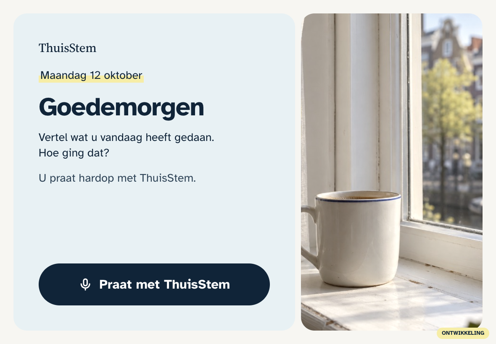
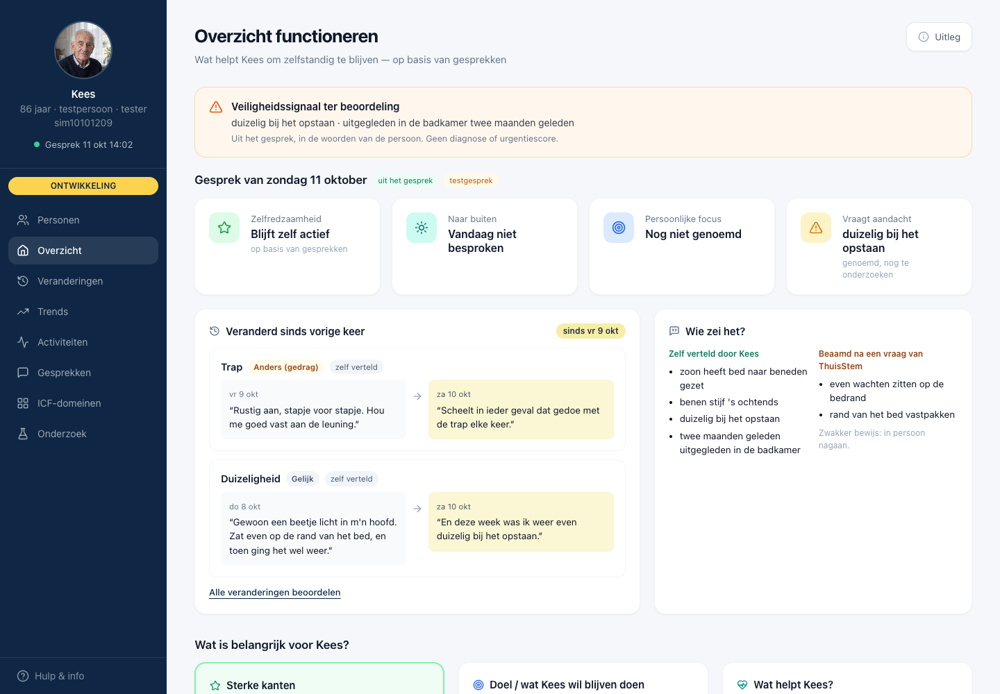
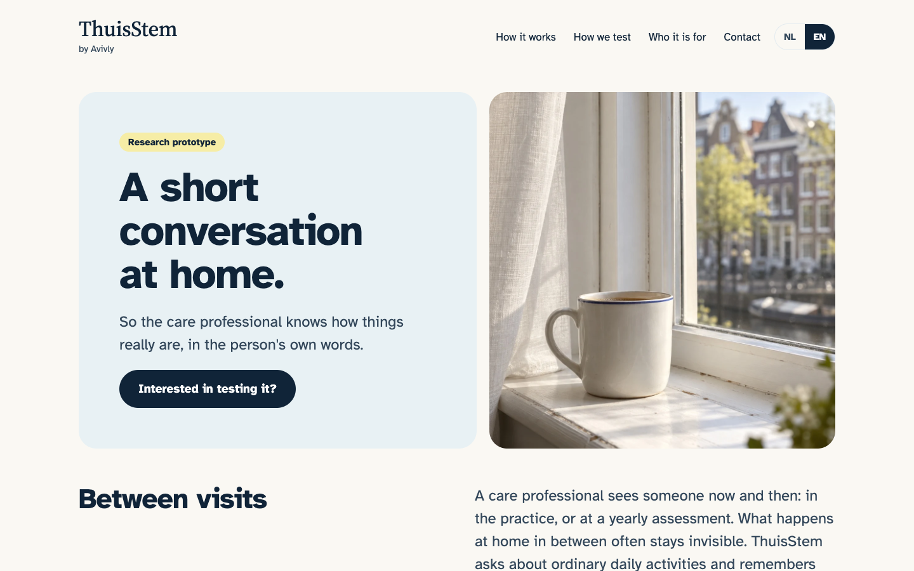
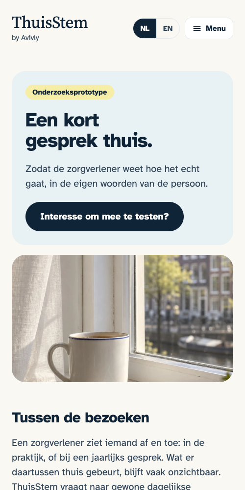
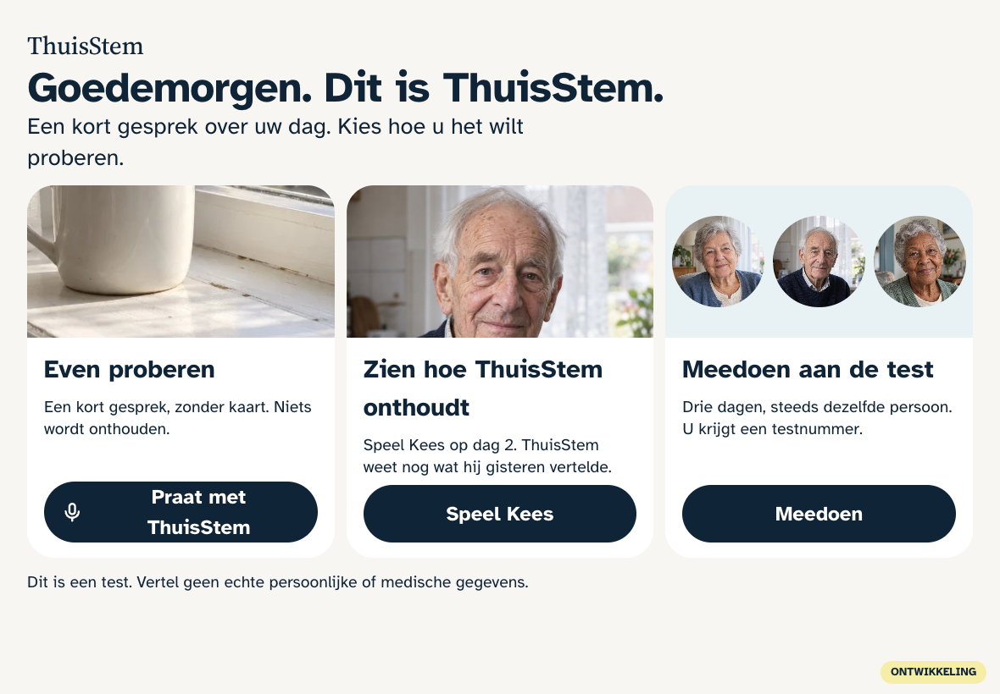
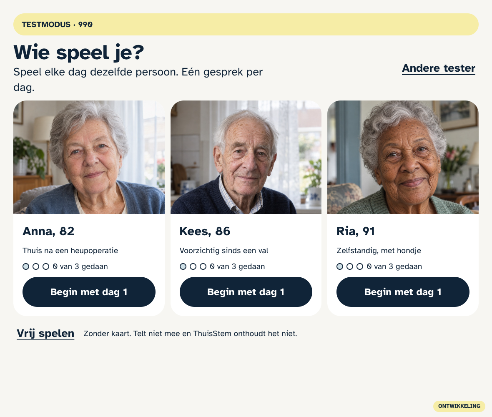
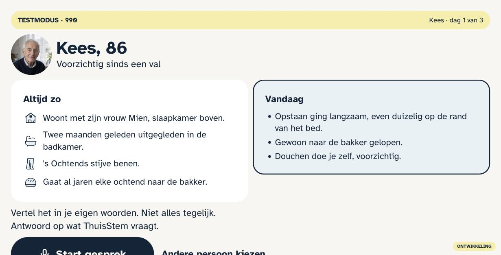
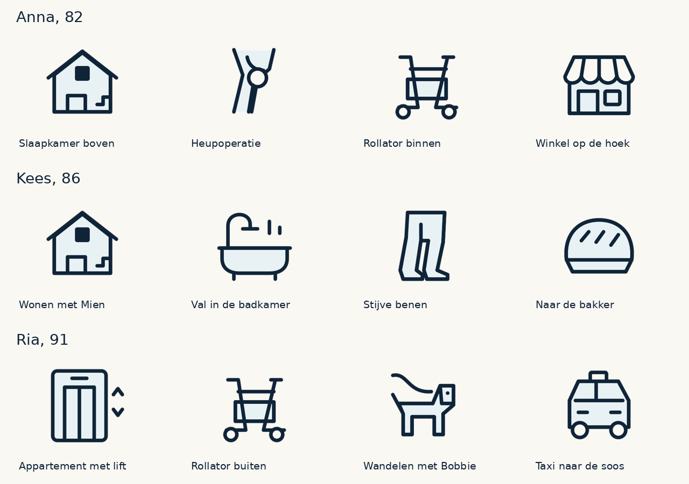

# ThuisStem

**A short conversation at home, so the care professional knows how things really are, in the person's own words.**

ThuisStem is a Dutch voice companion for older adults living at home. The person talks out loud about their day. The
care professional, such as a physiotherapist or a district nurse, sees what that means for daily functioning: in the
person's own words, linked to the international ICF framework, and what changed since the previous conversation.

**Status:** research prototype, in Dutch, always with a care professional in the loop. ThuisStem makes no diagnosis and
gives no treatment advice.

---

## The problem

A care professional sees someone now and then: in the practice, or at a yearly assessment. What happens at home in
between often stays invisible, until something goes wrong.

## How it works

1. **A conversation at home.** One button on a tablet, phone or computer. The person tells what they did today and how
   it went.
2. **Back to an earlier topic.** ThuisStem remembers earlier conversations and asks one open question about something
   said before, without steering.
3. **Own words as the source.** Every finding comes with the quote. Whether someone said it themselves or only agreed
   after a question stays visible.
4. **The professional decides.** What changed is shown with the words and dates of both conversations, and the
   professional confirms whether it is correct.
5. **Questions during a visit.** With the person's permission, the professional can consult a support assistant that
   answers briefly and never diagnoses.

---

## What it looks like

| At home | For the professional |
|---|---|
|  |  |

| Website | On a phone |
|---|---|
|  |  |

### How we test

Students and researchers play three fictional test persons over three days each. Because the story is known, we can
measure whether ThuisStem really notices the changes.

| Lab tablet | Choose a test person | Day card |
|---|---|---|
|  |  |  |

Anna, Kees and Ria are fictional; the portraits are generated. No real participant data is shown.

---

## Principles

- The professional keeps the judgement: no diagnosis, scores or treatment advice.
- Every finding is traceable to what the person actually said.
- Consent before anything is shared; the person stays in control.
- Test conversations are kept separate from real participants.
- Accessible for older adults: large text, one action per screen, plain Dutch.

## Contact

Interested in testing ThuisStem? Email **avivlyweb@gmail.com**.

---

© 2026 Avivly. All rights reserved. This page shows the product; the software itself is not published.
